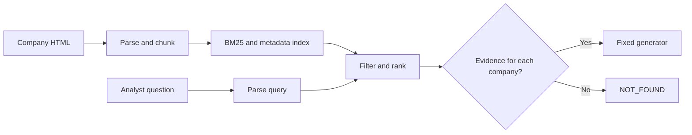

# FTEC5660 Homework 4

## Homework 4 solution

### Pipeline



The indexing stage reads the company, document type and reporting year from the HTML and converts each table row into a labelled line that keeps the original headings, cell values and units. It keeps tables apart from prose, repeats the relevant section heading and caption when a table spans multiple chunks, and caps each chunk at 1,500 characters. The index stores the original LangChain documents, a BM25 index and searchable provenance, including fiscal years found in table column headers. At query time, rules extract the companies, the requested year and the document type. These fields narrow the candidate pool while allowing a prior-year table column or a forecast in an earlier report to provide evidence. Ranking combines BM25 with line-level lexical coverage, table labels, relevant sections and period alignment. A comparison reserves a passage for each named company. If the issuer or period is unavailable, or the shortlisted passages offer insufficient positive lexical evidence for a requested fact, retrieval returns an empty list. Otherwise the original passages go to the supplied generator in ranked order, with at most five.

### Public-set ablation

Every row changes one component cumulatively. B0 uses BeautifulSoup's flat text, the recursive splitter with its default separators and overlap, a 1,500-character cap, lowercase whitespace tokens and unfiltered BM25 top five. The cap is explicit because the library's default chunk size exceeds the homework limit. The same cap also applies to all later variants. The official DeepSeek generator is the only model used in this project. The experiment uses evaluation labels only for scoring.

<!-- ABLATION_RESULTS_BEGIN -->

| Variant | Single component changed | Recall@5 | Single-fact top-1 | Comparison top-2 | Comparison top-5 | Kept | Rejected | Answer accuracy |
|---|---|---:|---:|---:|---:|---:|---:|---:|
| B0 | Naive RAG | 37.0% | 23.5% | 0.0% | 25.0% | 100.0% | 0.0% | 48.3% |
| V1 | Structure-aware chunks | 21.7% | 5.9% | 0.0% | 0.0% | 100.0% | 0.0% | 40.0% |
| V2 | Normalized lexical tokens | 15.2% | 5.9% | 0.0% | 0.0% | 100.0% | 0.0% | 35.0% |
| V3 | Metadata routing | 73.9% | 29.4% | 0.0% | 25.0% | 100.0% | 0.0% | 78.3% |
| V4 | Evidence-aware ranking | 100.0% | 100.0% | 100.0% | 100.0% | 100.0% | 0.0% | 100.0% |
| V5 | Comparison balancing | 100.0% | 100.0% | 100.0% | 100.0% | 100.0% | 0.0% | 100.0% |
| V6 | Evidence gate and abstention | 100.0% | 100.0% | 100.0% | 100.0% | 100.0% | 100.0% | 100.0% |

Observed answer-accuracy change relative to the preceding row — V1 -8.3 pp, V2 -5.0 pp, V3 +43.3 pp, V4 +21.7 pp, V5 +0.0 pp, V6 +0.0 pp.

Final variant answer errors (0/60) — none. Errors with a full retrieval hit — none.

<!-- ABLATION_RESULTS_END -->

Recall@5 requires every reference fact to occur in a returned passage from an accepted source. Single-fact top-1 is calculated on the 34 answerable questions with one evidence group. Comparison top-2 and top-5 count both required facts on the 12 comparison questions. Kept uses the 46 answerable questions, rejected uses the 14 unanswerable questions, and answer accuracy uses all 60 questions.

### What each change did

- **V1, structure-aware chunks.** Recall fell from B0's 37.0% to 21.7%. Section and table boundaries preserved the relationships needed to read values, but the index grew from 239 to 1,115 chunks. Under global BM25, many shorter chunks compete on common financial terms, and a table passage often lacks the company name used in the query.
- **V2, normalized lexical tokens.** Recall dropped to 15.2% with global retrieval. Token normalization gives punctuated dates, plural terms and some synonyms consistent forms. On this corpus it also makes generic financial terminology match across issuers more often. This incremental result measures its effect given V1.
- **V3, metadata routing.** Recall reached 73.9%. Filtering by the subject company, report type and eligible period reduces competition among similar reports. Since a prior-year column can supply the answer, the filter checks actual table years as well as the fiscal year on the cover.
- **V4, evidence-aware ranking.** Recall rose from 73.9% to 100.0%. Single-fact top-1 rose from 29.4% to 100.0%, and comparison top-2 rose from 0.0% to 100.0%. The reranker promotes rows that match the financial metric and period, and uses headings for items such as executive roles and independent auditors.
- **V5, company balancing.** The reported retrieval metrics stayed the same. V4 already placed evidence for both issuers in the first two passages for all public comparisons. V5 makes that coverage explicit by placing each named issuer's highest-ranked passage ahead of additional passages.
- **V6, positive evidence gate.** Rejection rose from 0.0% to 100.0% with all 46 answerable questions retained. This stage checks issuer and year coverage, requires a single line to support the core terms, and removes weaker passages before generation.

### Error analysis

- **Comparison, q021.** The baseline missed the evidence pair for the two issuers' FY2024 cash balances. V3 had eligible reports for both issuers but the top five still missed a required value. V4 returned evidence from both companies by favoring rows that match the metric and period.
- **Prior-year column, q024.** A returned document can be correct while its specific passage omits the answer. The B0 output included an eligible FY2024 annual report but missed the FY2023 Asia Pacific revenue evidence. V3 retained the FY2024 document and surfaced its regional revenue table with the FY2023 column.
- **Unavailable facts, q001 and q019.** V5 retrieved context for the similarly named company in q001 and for the genuine company with an undisclosed item in q019. V6 rejected the former at the exact issuer check and the latter at the lexical evidence check.
- **Residual risks.** Year-end executive questions can contain both a current officeholder and a predecessor. The executive table heading and the official question date help disambiguate them. A forecast can include both a new and a former estimate, so a full evidence hit still leaves a decision for the generator. The rule-based entity and evidence checks can also miss unfamiliar abbreviations or paraphrases. The measured retrieval results refer to the public set.

### Reproduction

From a fresh clone with Python 3.10 or newer, install the starter dependencies.

```bash
python3 -m pip install -r requirements.txt
```

Run the retrieval-only public experiment.

```bash
python3 ablation.py --data-folder public_test --output-dir ablation_offline
```

Set `DEEPSEEK_API_KEY` in the environment, then run the official scorer and the complete ablation. The ablation reuses the official answers for V6 and checks that its retrieval results match the official run. It saves a per-question CSV for each variant and a summary CSV. The last option updates the measured results and final answer errors in this README.

```bash
python3 hw4.py --data-folder public_test --output results.csv
python3 ablation.py --data-folder public_test --with-generator --official-results results.csv --output-dir ablation_results --update-readme README.md
```

## Reflection

Ten years from now, I would like to be someone people can trust with a difficult decision. I hope I still ask what the evidence supports, whose perspective is missing, and who bears the cost if the decision is wrong. I would like colleagues to remember that I listened carefully, gave others credit and admitted uncertainty early enough for it to matter.

I still want to understand how finance and technology can make decisions more transparent. My background in statistics and fintech gives me a reason to care about how numbers are defined, where they come from and what happens when they are compared. In a project such as extracting bank disclosures, an agent could collect and align hundreds of values. I would still want to work through a few difficult disclosures myself, compare the figures across tables and explain why two numbers that look comparable may have different meanings. Working through those cases helps me develop the judgment I will need when the tool's output is persuasive and the evidence is incomplete.

Beyond what I produce, I want to be known for being dependable and curious. I am willing to spend time learning an unfamiliar subject, having a difficult conversation and correcting an error I made. Patience, empathy, the ability to explain uncertainty and the willingness to take responsibility would still have value even if generating code and reports became effortless. I would define myself by the commitments I keep and the way I treat people when I am under pressure.

Tomorrow, I can start by writing down my own hypothesis before asking an agent, checking one important claim against its original source, and explaining my conclusion in my own words. I can also make time to listen to someone whose experience challenges an assumption I have made.
